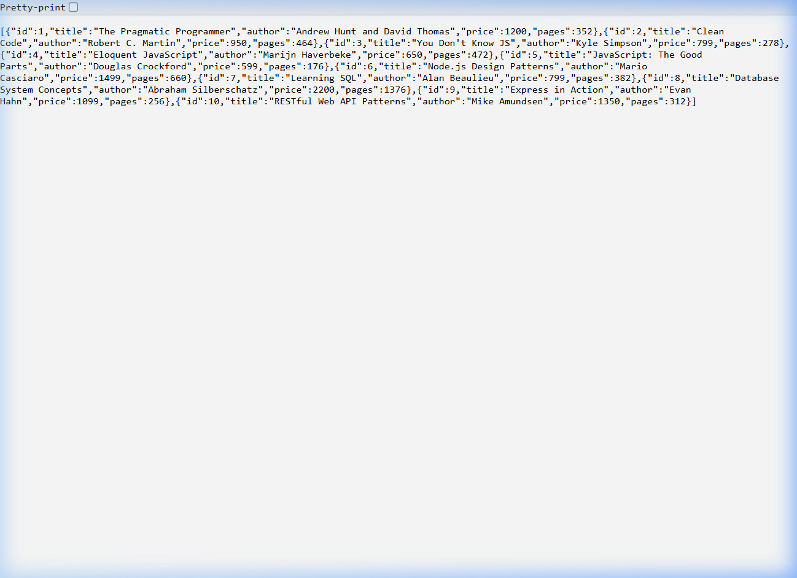
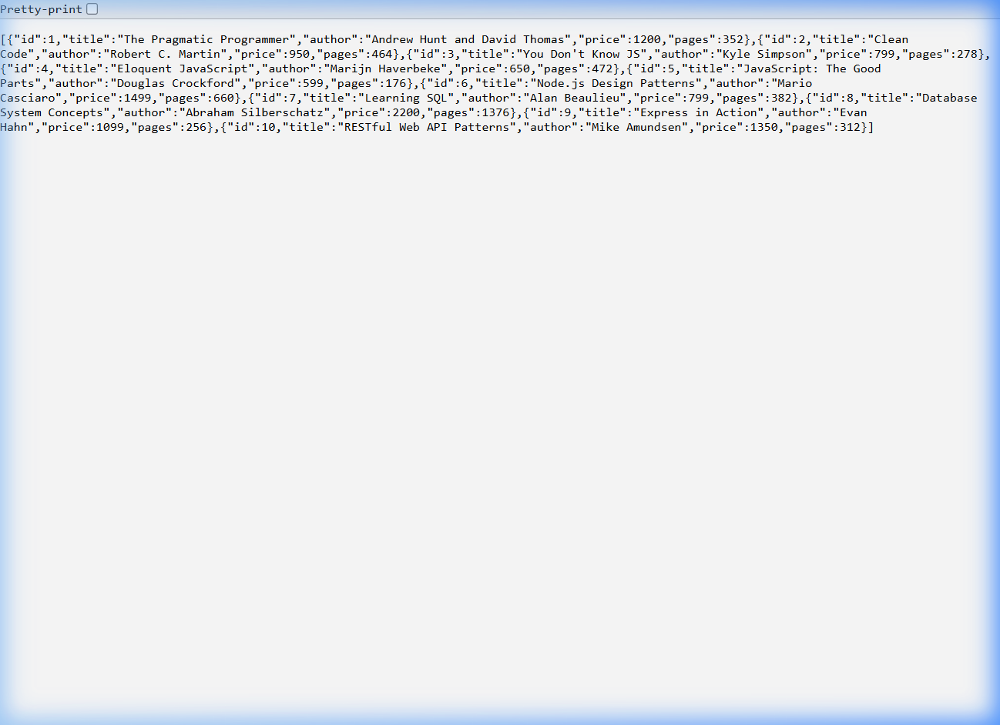
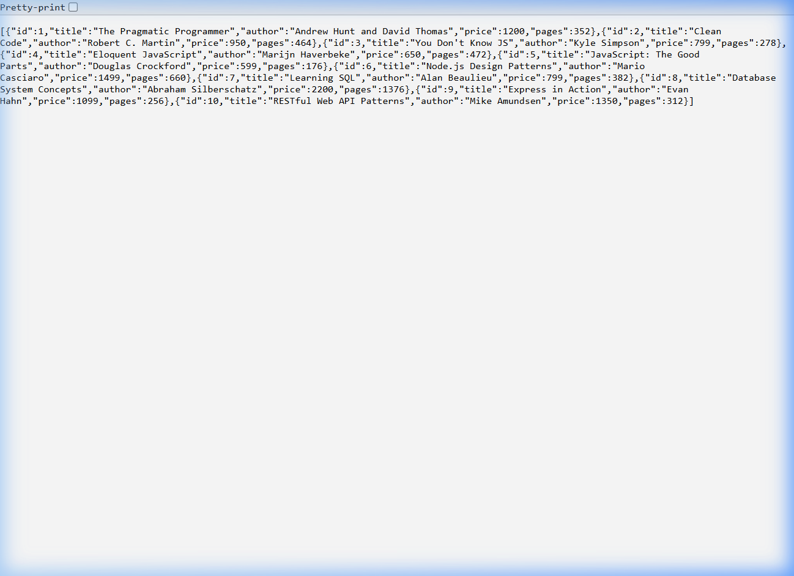
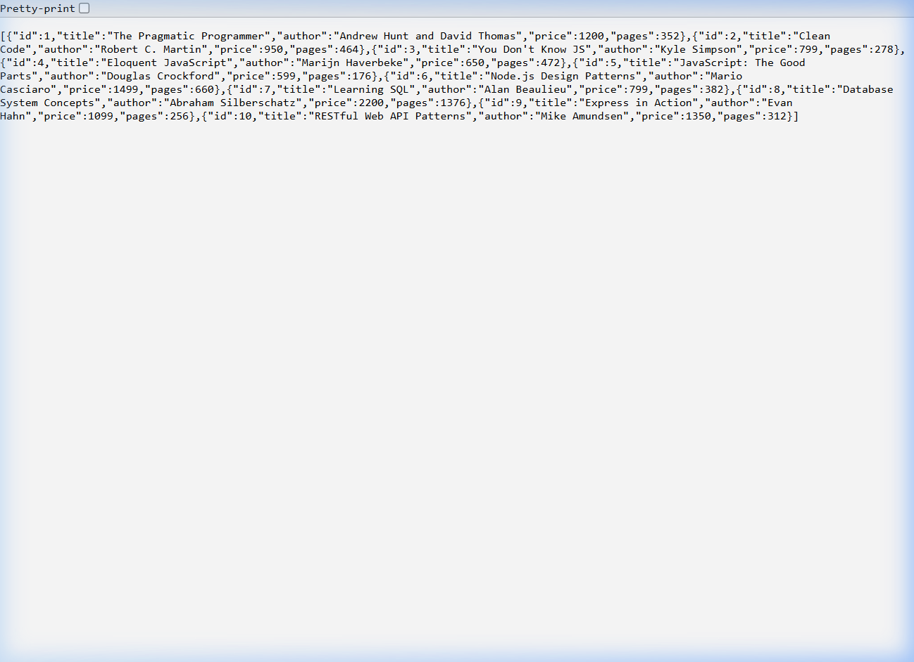
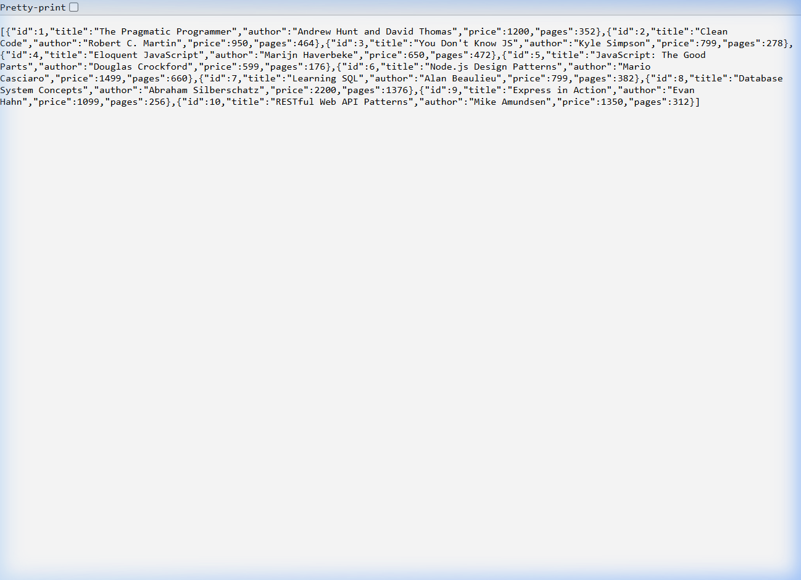

# Lab 2: SQLite Database and CRUD Routes

> **Backend Development Fundamentals** · Year II Term II · Aurora · Faculty: Joel Prashanth D

---

## 🚀 Live Deployment on Render

| | |
|---|---|
| **Live URL** | https://bdf-lab-02-dscw.onrender.com |
| **GitHub** | https://github.com/abhi2-cloud/BDF-Lab-02 |

**Quick test — open these in your browser:**
- 📚 Get all books → https://bdf-lab-02-dscw.onrender.com/books
- 🔍 Get book by ID → https://bdf-lab-02-dscw.onrender.com/books/1

> ⏱️ **First request may take 30–60 seconds** — Render's free tier sleeps after 15 minutes of inactivity. Subsequent requests are fast.

---

## Project Information

| Field               | Details                                   |
|---------------------|-------------------------------------------|
| **Lab Number**      | Lab 2                                     |
| **Lab Title**       | SQLite Database and CRUD Routes           |
| **Student Name**    | PAMPANA ABHI VEERA DURGA LAKSHMAN        |
| **Reg Number**      | 252U1R9115                                |
| **Section**         | CSE GEN AI 2B                             |
| **Faculty**         | Joel Prashanth D                          |
| **Content Week**    | 2 (slots 8–12)                            |

---

## Project Description

This project exposes a **Books CRUD REST API** built with **Node.js + Express.js** backed by an **SQLite** database (`books.db`). It demonstrates all four database operations — **Create**, **Read**, **Update**, and **Delete** — over five HTTP endpoints, using parameterized SQL queries to prevent SQL injection. The server uses an async `initializeDBAndServer()` function that opens the database connection before starting the HTTP listener, ensuring the API is only available once the database is ready.

---

## Technologies Used

| Technology     | Purpose                                      |
|----------------|----------------------------------------------|
| Node.js        | JavaScript runtime environment               |
| Express.js     | HTTP server and routing framework            |
| SQLite         | Embedded relational database                 |
| sqlite3 (npm)  | Node.js driver for SQLite                    |
| Nodemon        | Auto-restarts server on file changes (dev)   |
| Postman        | API testing and screenshot capture           |
| SQLite CLI     | Direct database inspection and verification  |
| npm            | Package manager                              |

---

## Database Structure

**Database file:** `books.db`  
**Table name:** `book`

| Column | Data Type               | Description                    |
|--------|-------------------------|--------------------------------|
| id     | INTEGER PRIMARY KEY     | Auto-incremented unique ID     |
| title  | TEXT NOT NULL           | Title of the book              |
| author | TEXT NOT NULL           | Author's name                  |
| price  | INTEGER NOT NULL        | Price of the book (in INR ₹)  |
| pages  | INTEGER NOT NULL        | Total number of pages          |

**Sample records inserted (10 books):**

| ID | Title                          | Author                        | Price (₹) | Pages |
|----|--------------------------------|-------------------------------|-----------|-------|
| 1  | The Pragmatic Programmer       | Andrew Hunt and David Thomas  | 1200      | 352   |
| 2  | Clean Code                     | Robert C. Martin              | 950       | 464   |
| 3  | You Don't Know JS              | Kyle Simpson                  | 799       | 278   |
| 4  | Eloquent JavaScript            | Marijn Haverbeke              | 650       | 472   |
| 5  | JavaScript: The Good Parts     | Douglas Crockford             | 599       | 176   |
| 6  | Node.js Design Patterns        | Mario Casciaro                | 1499      | 660   |
| 7  | Learning SQL                   | Alan Beaulieu                 | 799       | 382   |
| 8  | Database System Concepts       | Abraham Silberschatz          | 2200      | 1376  |
| 9  | Express in Action              | Evan Hahn                     | 1099      | 256   |
| 10 | RESTful Web API Patterns       | Mike Amundsen                 | 1350      | 312   |

---

## Installation Instructions

Clone the repository and install dependencies:

```bash
git clone https://github.com/abhi2-cloud/BDF-Lab-02.git
cd BDF_Lab_02
npm install
```

---

## Running the Project

### Development mode (with Nodemon – auto-restarts on changes)

```bash
npm run dev
```

### Production / Normal start

```bash
npm start
```

The server starts at **http://localhost:3000/**

> **Note:** The `books.db` database file is included in the repository with 10 pre-seeded records. On the first run the server creates the table and inserts sample data automatically if the table is empty.

---

## API Documentation

### Base URLs

| Environment | Base URL | When to use |
|-------------|----------|-------------|
| **Local Development** | `http://localhost:3000` | When running `npm start` or `npm run dev` on your machine |
| **Live Production (Render)** | `https://bdf-lab-02-dscw.onrender.com` | After deployment — accessible from anywhere |

#### Live GET Endpoint Links (click to test in browser)

| Endpoint | Local URL | Live Render URL |
|----------|-----------|----------------|
| Get All Books | http://localhost:3000/books/ | https://bdf-lab-02-dscw.onrender.com/books |
| Get Book by ID (ID = 1) | http://localhost:3000/books/1/ | https://bdf-lab-02-dscw.onrender.com/books/1 |

> For POST, PUT, and DELETE — use **Postman** and switch the base URL between local and Render as needed.

### Endpoints

| # | Method | Endpoint          | Description              | Request Body                                           | Response                             | Status Code |
|---|--------|-------------------|--------------------------|--------------------------------------------------------|--------------------------------------|-------------|
| 1 | GET    | `/books/`         | Retrieve all books       | None                                                   | JSON array of all book objects       | 200 OK      |
| 2 | GET    | `/books/:bookId/` | Retrieve a book by ID    | None                                                   | Single book JSON object              | 200 OK / 404|
| 3 | POST   | `/books/`         | Add a new book           | `{"title":"","author":"","price":0,"pages":0}`         | `{"message":"...","bookId":N}`       | 201 Created |
| 4 | PUT    | `/books/:bookId/` | Update an existing book  | Any combination of `title`, `author`, `price`, `pages` | `{"message":"Book ... updated"}` | 200 OK / 404|
| 5 | DELETE | `/books/:bookId/` | Delete a book by ID      | None                                                   | `{"message":"Book ... deleted"}`     | 200 OK / 404|

---

### API Details

#### API 1 – GET All Books

**Request:**
```
GET http://localhost:3000/books/
```

**Response (200 OK):**
```json
[
  { "id": 1, "title": "The Pragmatic Programmer", "author": "Andrew Hunt and David Thomas", "price": 1200, "pages": 352 },
  { "id": 2, "title": "Clean Code", "author": "Robert C. Martin", "price": 950, "pages": 464 }
]
```

---

#### API 2 – GET Book by ID

**Request:**
```
GET http://localhost:3000/books/1/
```

**Response (200 OK):**
```json
{ "id": 1, "title": "The Pragmatic Programmer", "author": "Andrew Hunt and David Thomas", "price": 1200, "pages": 352 }
```

**Error – Not Found (404):**
```json
{ "error": "Book with ID 999 not found." }
```

**Error – Invalid ID (400):**
```json
{ "error": "Invalid Book ID. ID must be a positive integer." }
```

---

#### API 3 – POST Add a New Book

**Request:**
```
POST http://localhost:3000/books/
Content-Type: application/json

{
  "title": "Atomic Habits",
  "author": "James Clear",
  "price": 599,
  "pages": 320
}
```

**Response (201 Created):**
```json
{ "message": "Book added successfully.", "bookId": 11 }
```

**Error – Missing fields (400):**
```json
{ "error": "Missing required fields: title, author, price, pages." }
```

---

#### API 4 – PUT Update a Book

**Request:**
```
PUT http://localhost:3000/books/11/
Content-Type: application/json

{
  "title": "Atomic Habits (Updated Edition)",
  "price": 699
}
```

**Response (200 OK):**
```json
{ "message": "Book with ID 11 updated successfully." }
```

---

#### API 5 – DELETE Remove a Book

**Request:**
```
DELETE http://localhost:3000/books/11/
```

**Response (200 OK):**
```json
{ "message": "Book with ID 11 deleted successfully." }
```

---

## SQL Query Design

All SQL queries use **parameterized `?` placeholders** to prevent SQL injection:

```javascript
// SELECT all
db.all("SELECT * FROM book", [], callback);

// SELECT one
db.get("SELECT * FROM book WHERE id = ?", [bookId], callback);

// INSERT
db.run("INSERT INTO book (title, author, price, pages) VALUES (?, ?, ?, ?)",
  [title, author, price, pages], callback);

// UPDATE
db.run("UPDATE book SET title = ?, author = ?, price = ?, pages = ? WHERE id = ?",
  [title, author, price, pages, bookId], callback);

// DELETE
db.run("DELETE FROM book WHERE id = ?", [bookId], callback);
```

> **Why parameterized queries?** User-supplied values are passed as separate parameters to the database driver. The driver sanitizes them before execution, so an attacker cannot inject SQL code through the request body or URL parameters.

---

## Testing

### Postman Testing

All five API endpoints were tested using Postman:

1. **GET `/books/`** – Returned all 10 books with status `200 OK`
2. **GET `/books/1/`** – Returned a single book with status `200 OK`
3. **POST `/books/`** – Added "Atomic Habits" and returned `201 Created` with the new `bookId`
4. **PUT `/books/11/`** – Updated the title and price, returned `200 OK`
5. **DELETE `/books/11/`** – Deleted the book, returned `200 OK`

Error cases tested:
- GET with a non-existent ID (`/books/999/`) → `404 Not Found`
- GET with an invalid ID (`/books/abc/`) → `400 Bad Request`
- POST without required fields → `400 Bad Request`
- PUT on non-existent ID → `404 Not Found`
- DELETE on non-existent ID → `404 Not Found`

### SQLite CLI Verification

After Postman operations, the database was verified directly:

```sql
-- List tables
.tables

-- Inspect schema
PRAGMA table_info(book);

-- Count records
SELECT COUNT(*) FROM book;

-- View all records
SELECT * FROM book;

-- Verify specific record
SELECT * FROM book WHERE id = 1;
```

The CLI confirmed:
- POST operation inserted a new record
- PUT operation changed the existing record's fields
- DELETE operation removed the selected record

---

## Screenshots

### GET All Books – `GET /books/`


### GET Book by ID – `GET /books/1/`


### POST Add Book – `POST /books/`


### PUT Update Book – `PUT /books/:bookId/`


### DELETE Book – `DELETE /books/:bookId/`


### SQLite Database Verification


---

## Viva Questions

**1. Why await the database call?**  
SQLite operations are asynchronous in Node.js. Awaiting (or using callbacks) ensures the database result is fully returned before sending the HTTP response. Without it, the response might be sent before the query completes, returning `undefined` or an empty result.

**2. What is SQL injection and how do placeholders prevent it?**  
SQL injection is an attack where malicious SQL code is embedded in user input (e.g., `'; DROP TABLE book; --`). Parameterized queries with `?` placeholders pass values to the database driver separately, so the driver escapes them as data — they can never be interpreted as SQL commands.

**3. When is PUT used instead of POST?**  
- **POST** is used to *create* a new resource. The server assigns a new ID.
- **PUT** is used to *replace or update* an existing resource identified by its ID in the URL. If you send the same PUT request twice, the result is the same (idempotent).

---

## GitHub and Deployment

### GitHub Repository

**Repository URL:** https://github.com/abhi2-cloud/BDF-Lab-02

```bash
git clone https://github.com/abhi2-cloud/BDF-Lab-02.git
cd BDF-Lab-02
npm install
npm start
```

---

## Live Deployment on Render

The application is successfully deployed on **Render** as a free Web Service.

### 🌐 Live Application URL

```
https://bdf-lab-02-dscw.onrender.com
```

### Render Deployment Configuration

| Field | Value |
|-------|-------|
| **Platform** | Render Free Web Service |
| **Build Command** | `npm install` |
| **Start Command** | `npm start` |
| **Branch** | `main` |
| **Repository** | https://github.com/abhi2-cloud/BDF-Lab-02 |

### Testing the Live API

Open the following URLs directly in a browser to test the GET endpoints:

| Endpoint | Live URL |
|----------|----------|
| Get All Books | https://bdf-lab-02-dscw.onrender.com/books |
| Get Book by ID (ID = 1) | https://bdf-lab-02-dscw.onrender.com/books/1 |

For POST, PUT, and DELETE operations, use **Postman** with the base URL:
```
https://bdf-lab-02-dscw.onrender.com
```

### ⏱️ Render Free Tier – Sleep Warning

Render's free Web Service **automatically goes to sleep after approximately 15 minutes of inactivity**.

- The **first request after a sleep period may take 30–60 seconds** to respond while the instance wakes up.
- Subsequent requests will respond at normal speed.
- This is expected behaviour on the free plan and does not indicate an error.

### ⚠️ SQLite Data Persistence Warning

Render's free tier uses **ephemeral (temporary) disk storage**. This has the following implications:

| Action | Effect on `books.db` |
|--------|---------------------|
| Instance restart or sleep/wake | Data written at runtime **may be lost** |
| New deployment (code push) | `books.db` **resets** to the committed version (10 seed records) |
| POST / PUT / DELETE via live URL | Changes work for the current session only |

The 10 pre-seeded book records committed to the repository will always be present after a fresh deploy or restart.

> For production-level persistence, use a managed database such as **PostgreSQL** (available on Render's free tier), **Neon**, or **Supabase**. SQLite is appropriate for this college lab demonstration.

---

## Notes – Problems Faced and How They Were Solved

| Problem | Solution |
|---------|----------|
| PowerShell does not support `&&` as a statement separator | Used `;` to chain commands in PowerShell |
| Backtick template literals caused parse errors in inline `node -e` scripts | Moved the script to a dedicated `seed.js` file and ran `node seed.js` |
| SQLite `sqlite3` driver uses callbacks, not Promises by default | Used `db.serialize()` to sequence operations and callbacks to handle async results |

---

*End of README – Lab 2: SQLite Database and CRUD Routes*
